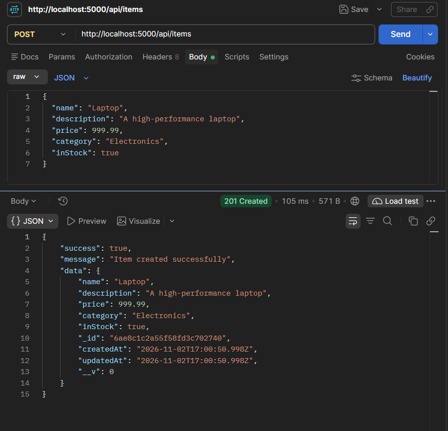
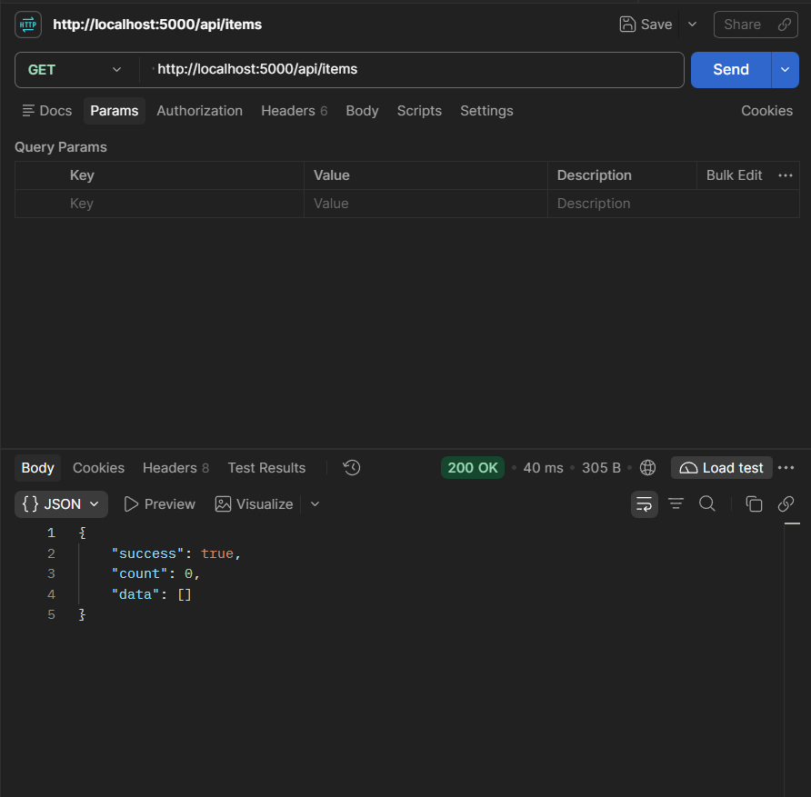
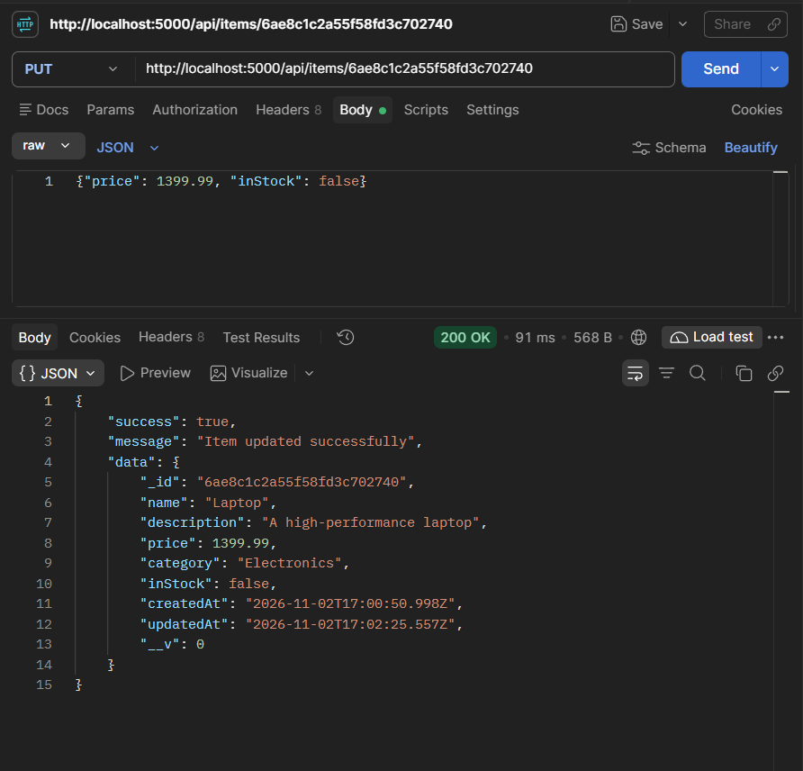
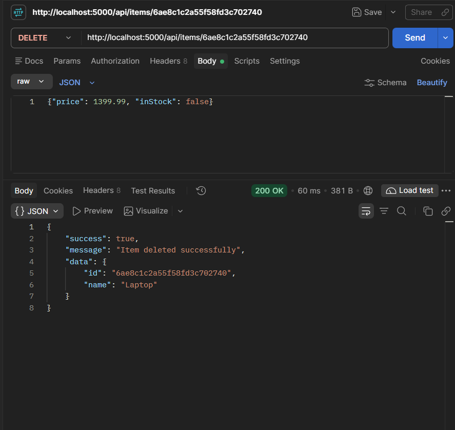

<div align="center">

# ⚡ Backend Tutorial: Node.js, Express & MongoDB Atlas REST API

<p align="center">
  <strong>A production-ready, fully-tested RESTful CRUD API service built with Node.js, Express, and MongoDB Atlas.</strong>
</p>

<p align="center">
  
  
  
  
  
  
  
</p>

---

</div>

## 📌 Table of Contents
- [Overview](#-overview)
- [Architecture & Folder Structure](#-architecture--folder-structure)
- [API Endpoints Reference](#-api-endpoints-reference)
- [Postman API Testing](#-postman-api-testing)
  - [1. CREATE — Add New Item (POST)](#1-create--add-new-item-post)
  - [2. READ ALL — Fetch All Items (GET)](#2-read-all--fetch-all-items-get)
  - [3. UPDATE — Update Item by ID (PUT)](#3-update--update-item-by-id-put)
  - [4. DELETE — Delete Item by ID (DELETE)](#4-delete--delete-item-by-id-delete)
- [Installation & Setup](#-installation--setup)
- [Environment Configuration](#-environment-configuration)
- [Running the Project](#-running-the-project)

---

## 📖 Overview

This repository contains a full-stack backend application implementing standard REST architecture and the **Model-Route-Controller (MRC)** pattern:

- **Create**: Insert new item documents into MongoDB Atlas with strict schema validation.
- **Read**: Fetch all items or a single item by 24-character hexadecimal MongoDB ObjectId.
- **Update**: Update item attributes with validation and updated timestamps.
- **Delete**: Safely remove documents from the cloud database.
- **Error Handling**: Graceful error handling for missing fields (`400`), invalid ID format (`400`), and resource not found (`404`).

---

## 🏗️ Architecture & Folder Structure

```text
backend-project/
│
├── config/
│   └── db.js                 # MongoDB Atlas connection logic via Mongoose
│
├── controllers/
│   └── itemController.js     # CRUD business logic handlers
│
├── models/
│   └── Item.js               # Mongoose schema definition with validation rules
│
├── routes/
│   └── itemRoutes.js         # REST route endpoints mapped to controllers
│
├── screenshots/              # Postman testing execution proof
│   ├── 01-create-item.png
│   ├── 02-get-all-items.png
│   ├── 03-update-item.png
│   └── 04-delete-item.png
│
├── tests/
│   └── testApi.js            # Automated verification test suite
│
├── .env                      # Local environment secrets (Git-ignored)
├── .env.example              # Environment variables template
├── .gitignore                # Safeguard excluding secrets and dependencies
├── package.json              # Project manifest and scripts
├── postman_collection.json   # Ready-to-import Postman collection
├── server.js                 # Express application entry point
└── README.md                 # Project documentation
```

---

## ⚡ API Endpoints Reference

| Method | Endpoint | Description | Status Code |
| :---: | :--- | :--- | :---: |
| `GET` | `/` | Health check & API documentation overview | `200 OK` |
| `POST` | `/api/items` | Create a new item | `201 Created` |
| `GET` | `/api/items` | Retrieve all items (supports search & filters) | `200 OK` |
| `GET` | `/api/items/:id` | Retrieve single item by MongoDB ObjectId | `200 OK` / `404` |
| `PUT` | `/api/items/:id` | Update item attributes by ID | `200 OK` / `404` |
| `DELETE` | `/api/items/:id` | Remove item permanently by ID | `200 OK` / `404` |

---

## 🧪 Postman API Testing

All endpoints have been tested directly against the live **MongoDB Atlas** database using Postman. Below are the actual execution results:

### 1. CREATE — Add New Item (POST)
- **Method / URL**: `POST http://localhost:5000/api/items`
- **Status**: `201 Created`
- **Payload**: Inserts item with name, description, price, category, and inStock status.



---

### 2. READ ALL — Fetch All Items (GET)
- **Method / URL**: `GET http://localhost:5000/api/items`
- **Status**: `200 OK`
- **Description**: Returns all items stored in the MongoDB Atlas collection.



---

### 3. UPDATE — Update Item by ID (PUT)
- **Method / URL**: `PUT http://localhost:5000/api/items/:id`
- **Status**: `200 OK`
- **Payload**: Modifies price to `1399.99` and toggles `inStock` to `false`.



---

### 4. DELETE — Delete Item by ID (DELETE)
- **Method / URL**: `DELETE http://localhost:5000/api/items/:id`
- **Status**: `200 OK`
- **Description**: Permanently removes the item from the database.



---

## 🚀 Installation & Setup

### 1. Clone Repository
```bash
git clone https://github.com/RupeshthakuR-error/learning-Backend.git
cd learning-Backend
```

### 2. Install Dependencies
```bash
npm install
```

---

## 🔐 Environment Configuration

Create a `.env` file in the root directory by copying the template:

```bash
cp .env.example .env
```

Configure your variables:

```env
PORT=5000
NODE_ENV=development
MONGO_URI=mongodb+srv://<username>:<password>@cluster0.jn0mmcr.mongodb.net/backendTutorialDB?authSource=admin&retryWrites=true&w=majority
```

> **Security Note:** The `.env` file is untracked and excluded from version control via `.gitignore` to prevent credential exposure.

---

## 💻 Running the Project

### Development Mode (with hot-reload)
```bash
npm run dev
```

### Production Mode
```bash
npm start
```

### Run Automated API Tests
```bash
npm test
```

---

<div align="center">
  <sub>Built with ❤️ by Rupesh Thakur</sub>
</div>
